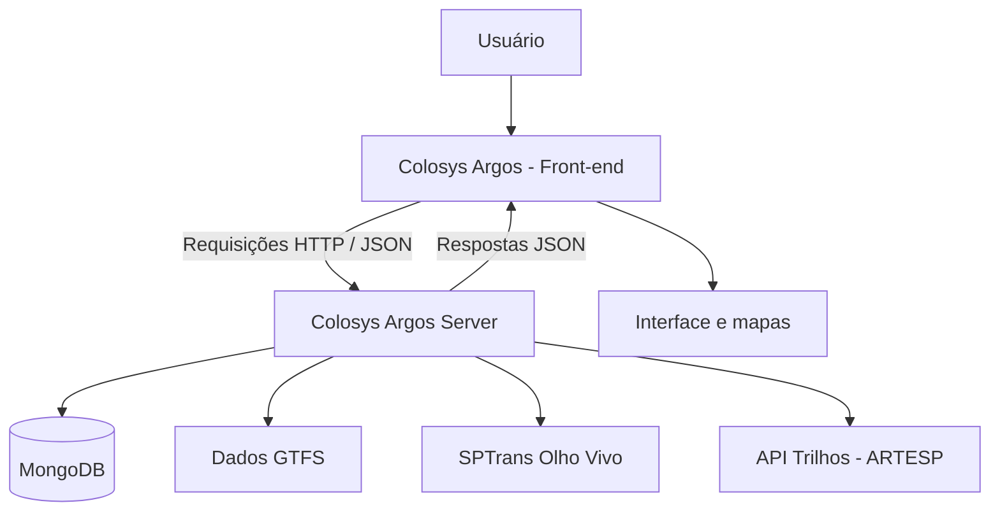

# Colosys Argos

<p align="center">
  
</p>

<p align="center">
  <strong>Mobilidade urbana mais acessível, informação mais próxima de você.</strong>
</p>

<p align="center">
  <a href="https://global-solution-2026-smoky.vercel.app">
    
  </a>
  <a href="https://github.com/B347r12666/global-solution-2026-2">
    
  </a>
  <a href="https://github.com/MurilloFonseca/colosys-argos-server">
    
  </a>
</p>

---

## Sobre o projeto

O **Colosys Argos** é uma plataforma voltada à mobilidade urbana, desenvolvida para facilitar o acesso a informações sobre o transporte público.

A proposta é reunir, em um único ambiente, recursos que auxiliem os usuários a consultar linhas de transporte, pesquisar trajetos, visualizar informações em mapas e acompanhar avisos relacionados ao sistema de transporte.

A plataforma também oferece recursos de personalização e participação dos usuários, como gerenciamento de linhas e trajetos favoritos e envio de relatos.

Este repositório contém o **front-end web** da aplicação, responsável pela interface e pela interação dos usuários com os serviços disponibilizados pelo back-end.

## Acesse a plataforma

A aplicação está publicada e pode ser acessada pelo link:

**[Colosys Argos — Acessar plataforma](https://global-solution-2026-smoky.vercel.app)**

## Vídeo de apresentação

Conheça a proposta e a solução por meio do vídeo de apresentação:

<p align="center">
  <a href="https://youtu.be/y-5OvBYM4xw">
    
  </a>
</p>

<p align="center">
  <a href="https://youtu.be/y-5OvBYM4xw">Assistir ao vídeo no YouTube</a>
</p>

## Funcionalidades

A plataforma reúne funcionalidades relacionadas à consulta e ao acompanhamento do transporte público:

| Funcionalidade | Descrição |
|---|---|
| **Autenticação** | Cadastro e login de usuários. |
| **Consulta de linhas** | Pesquisa e visualização de informações das linhas de transporte. |
| **Mapas** | Visualização geográfica de informações relacionadas às linhas e trajetos. |
| **Pesquisa de trajetos** | Busca de possibilidades de deslocamento entre uma origem e um destino. |
| **Paradas** | Consulta de informações sobre as paradas associadas às linhas. |
| **Tarifas** | Consulta de informações tarifárias do transporte. |
| **Avisos** | Exibição de comunicados relacionados ao sistema de transporte. |
| **Favoritos** | Armazenamento e consulta de linhas e trajetos favoritos. |
| **Relatos** | Envio e consulta de relatos relacionados ao transporte público. |
| **Informações em tempo real** | Consulta de posições de ônibus e previsões de chegada, quando disponibilizadas pelas fontes de dados. |

### Limitação do roteamento

Atualmente, a pesquisa de trajetos identifica somente **rotas diretas**, ou seja, deslocamentos realizados sem a necessidade de baldeação entre linhas.

As estimativas de duração são baseadas nos dados disponíveis e não representam necessariamente horários de partida ou chegada em tempo real.

## Tecnologias utilizadas

O front-end foi desenvolvido utilizando as seguintes tecnologias:

| Tecnologia | Aplicação |
|---|---|
| [React 19](https://react.dev/) | Construção da interface baseada em componentes. |
| [Vite](https://vite.dev/) | Ambiente de desenvolvimento e ferramenta de build. |
| [React Router DOM 7](https://reactrouter.com/) | Gerenciamento de rotas e navegação. |
| [Tailwind CSS 4](https://tailwindcss.com/) | Estilização da interface. |
| [Axios](https://axios-http.com/) | Comunicação HTTP com a API. |
| [Leaflet](https://leafletjs.com/) | Biblioteca de mapas interativos. |
| [React Leaflet](https://react-leaflet.js.org/) | Integração do Leaflet com React. |
| [Font Awesome](https://fontawesome.com/) | Ícones da interface. |

## Arquitetura e integração

O projeto utiliza uma arquitetura cliente-servidor. O front-end é responsável pela apresentação das informações e pela interação com o usuário, enquanto o back-end centraliza a lógica de negócio, autenticação, acesso aos dados e integração com fontes externas.

### Repositório do back-end

O servidor utilizado pelo Colosys Argos está disponível em:

**[Colosys Argos Server — GitHub](https://github.com/MurilloFonseca/colosys-argos-server)**

O back-end utiliza:

- **FastAPI:** construção da API REST.
- **MongoDB:** armazenamento dos dados.
- **JWT:** autenticação e autorização de requisições.
- **GTFS:** dados estruturados do transporte público.
- **SPTrans Olho Vivo:** integração para informações operacionais de ônibus.
- **API Trilhos (ARTESP):** integração para informações relacionadas ao transporte sobre trilhos.

A comunicação entre o front-end e o servidor é realizada por meio de requisições HTTP.

### Fluxo simplificado



### Autenticação

As operações que exigem autenticação utilizam tokens JWT.

Após o login, o token de acesso é utilizado nas requisições protegidas, por meio do cabeçalho HTTP:

```http
Authorization: Bearer <token>
```

## Como executar localmente

### Pré-requisitos

Antes de iniciar, certifique-se de possuir:

- [Node.js](https://nodejs.org/) instalado.
- npm (incluído na instalação do Node.js).
- Acesso a uma instância do back-end Colosys Argos Server.

### 1. Clonar o repositório

```bash
git clone https://github.com/B347r12666/global-solution-2026-2.git
```

Entre na pasta do projeto:

```bash
cd global-solution-2026-2
```

### 2. Instalar as dependências

```bash
npm install
```

### 3. Configurar as variáveis de ambiente

Crie um arquivo `.env` a partir do arquivo de exemplo:

```bash
cp .env.example .env
```

No Windows PowerShell, utilize:

```powershell
Copy-Item .env.example .env
```

O arquivo `.env` deve conter:

```env
VITE_API_URL=http://localhost:8000
```

A variável `VITE_API_URL` define o endereço-base da API utilizada pelo front-end.

Caso o back-end esteja sendo executado em outro endereço ou porta, atualize esse valor de acordo com a configuração do servidor.

> **Importante:** variáveis com prefixo `VITE_` são disponibilizadas no código do front-end. Portanto, não armazene senhas, tokens secretos ou credenciais privadas nesse arquivo.

### 4. Iniciar o servidor de desenvolvimento

Com as dependências instaladas e as variáveis configuradas, execute:

```bash
npm run dev
```

Por padrão, o Vite disponibiliza a aplicação em:

```text
http://localhost:5173
```

A aplicação estará pronta para ser acessada pelo navegador.

### 5. Executar o back-end

O front-end depende do servidor para obter os dados e executar operações da aplicação.

Siga as instruções de instalação e configuração disponíveis no README do repositório:

[Colosys Argos Server — Instruções de instalação](https://github.com/MurilloFonseca/colosys-argos-server)

Certifique-se de que o endereço configurado em `VITE_API_URL` corresponde ao endereço em que a API está sendo executada.

Além disso, o back-end precisa permitir a origem do front-end nas configurações de CORS.

## Scripts disponíveis

Os seguintes comandos estão definidos no `package.json`:

| Comando | Descrição |
|---|---|
| `npm run dev` | Inicia o servidor de desenvolvimento do Vite. |
| `npm run build` | Gera a versão de produção da aplicação. |
| `npm run preview` | Executa uma prévia local da versão de produção. |
| `npm run lint` | Executa a análise estática do código com ESLint. |

Para gerar a versão de produção:

```bash
npm run build
```

Os arquivos compilados serão disponibilizados no diretório `dist/`.

## Estrutura do projeto

A organização principal do front-end está dividida em páginas, componentes, autenticação e comunicação com a API.

```text
global-solution-2026-2/
│
├── public/
│   ├── favicon.ico
│   ├── logo_branco.png
│   └── logo_vermelho.png
│
├── src/
│   ├── api/              # Comunicação com o back-end
│   ├── auth/             # Recursos relacionados à autenticação
│   ├── components/       # Componentes reutilizáveis
│   ├── pages/            # Páginas da aplicação
│   ├── App.jsx           # Componente principal
│   ├── index.css         # Estilos globais
│   └── main.jsx          # Ponto de entrada da aplicação
│
├── .env.example          # Exemplo de configuração de ambiente
├── index.html
├── package.json
├── vite.config.js
└── README.md
```

### Páginas da aplicação

As páginas principais estão organizadas em `src/pages/`:

- `Home.jsx` — página inicial.
- `Login.jsx` — autenticação de usuários.
- `Cadastro.jsx` — cadastro de usuários.
- `Linhas.jsx` — consulta de linhas.
- `Rotas.jsx` — pesquisa de trajetos.
- `Tarifas.jsx` — consulta de tarifas.
- `Avisos.jsx` — exibição de avisos.
- `Favoritos.jsx` — gerenciamento de favoritos.
- `Relatos.jsx` — consulta e envio de relatos.

Os componentes reutilizáveis estão organizados em `src/components/`.

## Deploy

O front-end está publicado na plataforma Vercel.

- **Aplicação:** https://global-solution-2026-smoky.vercel.app
- **Hospedagem:** [Vercel](https://vercel.com/)

Para que a aplicação publicada funcione corretamente, a variável de ambiente `VITE_API_URL` deve apontar para o endereço público do back-end. O servidor também precisa permitir a origem do domínio publicado nas configurações de CORS.

## Equipe

Integrantes responsáveis pelo desenvolvimento do projeto:

| Integrante | RM |
|---|---|
| Beatriz dos Santos Silva | 573698 |
| Lorenzo Mendes Pena | 570036 |
| Maria Clara Ramos Santini | 573246 |
| Murillo Perez da Fonseca | 573674 |


## Repositórios relacionados

| Projeto | Repositório |
|---|---|
| **Colosys Argos — Front-end** | [B347r12666/global-solution-2026-2](https://github.com/B347r12666/global-solution-2026-2) |
| **Colosys Argos — Back-end** | [MurilloFonseca/colosys-argos-server](https://github.com/MurilloFonseca/colosys-argos-server) |

---

<p align="center">
  <strong>Colosys Argos</strong><br />
  Mobilidade urbana conectada à informação.
</p>